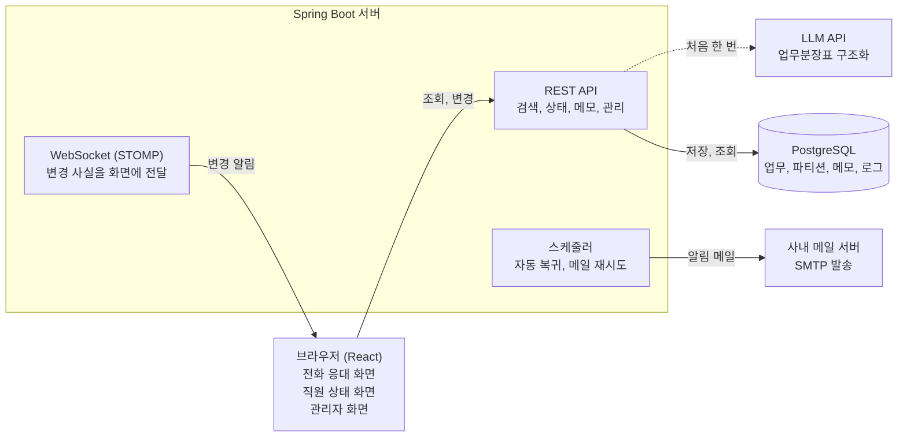

# 전화 응대 매니저웹 개발 계획

2026-11-17 재점검

1인 개발 기준 8주에 1차 오픈하는 계획입니다. Spring Boot(Java) 서버와 React 화면을 jar 하나로 묶어 사내망 서버에 올리고, 실시간 갱신은 WebSocket으로 처리합니다. AI는 처음 업무분장표를 구조화할 때만 쓰고 평소 검색과 상태 관리는 일반 기능으로 돌아갑니다.

관련 문서: [배포 체크리스트](deploy-checklist.md), [환경 설정](environment-setup.md)

## 범위

1차 오픈에는 전화 한 건을 처음부터 끝까지 응대하는 데 필요한 기능을 넣고, 예약과 이력, 통계는 2차로 미룹니다.

| 기능 | 내용 | 단계 |
| --- | --- | --- |
| 업무 검색 | 문의 주제를 검색하면 처리 가능한 업무, 주담당자, 부담당자, 내선번호 표시 | 1차 |
| 부담당자 자동 안내 | 주담당자가 연가나 자리비움이면 부담당자를 위로 표시 | 1차 |
| 처리 불가 문의 안내 | 사무실 업무가 아닌 문의는 넘겨줄 부서와 번호 표시 | 1차 |
| 파티션 신호등 | 배치도 위에 있음, 자리비움(종료 시각 포함), 연가를 색으로 표시하고 실시간 갱신 | 1차 |
| 본인 상태 변경 | 각자 자기 자리 상태를 바꾸고, 종료 시각이 지나면 자동으로 있음으로 복귀 | 1차 |
| 파티션 메모 | 자리마다 메모 달기 | 1차 |
| 전화 메모 | 발신자, 용건, 회신 번호를 기록해 파티션에 표시하고 회신 완료 체크 | 1차 |
| 알림 메일 | 파티션에 설정한 주소로 알림 메일 발송, 실패 시 재시도 | 1차 |
| AI 구조화 | 업무분장표를 업무, 키워드, 담당자 데이터로 변환한 뒤 검수 | 1차 |
| 관리자 화면 | 직원, 파티션 격자 배치, 업무, 키워드 관리 | 1차 |
| 검색 실패 로그 | 결과가 없던 검색어를 모아 키워드 보강에 사용 | 1차 |
| 배치도 드래그 편집 | 파티션을 끌어서 배치 | 2차 |
| 상태 예약 | 연가와 정기 회의를 미리 등록 | 2차 |
| 변경 이력 | 업무분장을 누가 언제 바꿨는지 기록 | 2차 |
| 문의 통계 | 자주 찾는 주제와 시간대 집계 | 2차 |

## 구조

평소에는 서버와 DB만으로 돌고, AI는 처음 한 번만 호출합니다.



화면은 REST로 조회하고 변경하며, 서버는 변경이 생길 때마다 웹소켓으로 열려 있는 모든 화면에 알립니다. LLM API는 업무분장표를 구조화할 때만 호출하므로 평소 운영은 서버, DB, 메일 서버만으로 돌아갑니다.

| 영역 | 선택 | 이유 |
| --- | --- | --- |
| 서버 | Java 25(LTS), Spring Boot 4.1, Spring Security 세션 로그인 | 내부 도구에는 세션 방식이 가장 단순 |
| 실시간 | Spring WebSocket과 STOMP | 주제 구독 방식이라 배치도 전체 알림과 개인 알림을 나누기 쉬움 |
| DB | PostgreSQL, Spring Data JPA, Flyway | 스키마 변경을 버전으로 관리 |
| 메일 | Spring Mail과 발송 대기열 테이블 | 메일 서버 장애 때 다시 보낼 수 있음 |
| 화면 | React, TypeScript, Vite, STOMP 클라이언트(@stomp/stompjs) | 배치도와 실시간 갱신을 컴포넌트로 구성 |
| 빌드 | Gradle이 React 빌드를 포함해 jar 하나 생성 | 배포 파일이 하나라 운영이 단순 |

## 데이터 모델

테이블은 10개입니다. 전화 메모와 메일 발송을 분리해, 메일이 실패해도 메모는 남고 나중에 다시 보낼 수 있게 합니다.

| 테이블 | 주요 필드 | 용도 |
| --- | --- | --- |
| `member` | 이름, 로그인 ID, 비밀번호 해시, 역할(관리자, 직원), 내선번호 | 직원과 로그인 계정 |
| `seat` | 라벨, 배치 좌표, 앉는 직원, 알림 메일 주소, 현재 상태, 종료 예정 시각, 사유 | 파티션과 현재 신호등 상태 |
| `status_schedule` | 파티션, 상태, 시작, 종료, 반복 규칙 | 연가와 정기 회의 예약(2차) |
| `task` | 업무명, 설명, 주담당자, 부담당자, 처리 가능 여부, 안내 부서와 번호 | 처리하는 업무와 넘겨줄 곳 |
| `task_keyword` | 업무, 단어, 종류(키워드, 동의어) | 검색 대상 단어 |
| `seat_note` | 파티션, 작성자, 내용, 작성 시각 | 파티션 메모 |
| `call_memo` | 대상 파티션, 발신자 이름, 회신 번호, 용건, 받은 시각, 작성자, 회신 완료 시각 | 전화 메모 |
| `mail_outbox` | 수신 주소, 제목, 본문, 상태, 재시도 횟수 | 메일 발송 대기열 |
| `search_log` | 검색어, 결과 수, 시각 | 검색 실패 분석 |
| `change_log` | 대상, 변경자, 변경 전후 값, 시각 | 변경 이력(2차) |

## API와 웹소켓

조회와 변경은 모두 REST로 하고, 웹소켓은 `/ws` 주소로 STOMP 연결을 맺어 변경 사실을 화면에 알리는 데만 씁니다. 연결이 끊겼다 돌아오면 화면이 배치도 전체를 다시 불러옵니다.

| 영역 | 호출 | 설명 |
| --- | --- | --- |
| 로그인 | `POST /api/auth/login`, `POST /api/auth/logout` | 세션 기반 로그인 |
| 검색 | `GET /api/search?q=` | 업무, 주담당자, 부담당자, 담당자 현재 상태를 함께 반환하고 검색어를 기록 |
| 배치도 | `GET /api/seats` | 전체 파티션, 현재 상태, 메모 수 |
| 상태 | `PUT /api/seats/{id}/status` | 상태와 종료 시각 변경(본인 또는 관리자) |
| 파티션 메모 | `GET`, `POST /api/seats/{id}/notes`, `DELETE /api/notes/{id}` | 메모 조회, 등록, 삭제 |
| 전화 메모 | `POST /api/call-memos`, `GET /api/call-memos?seatId=`, `PATCH /api/call-memos/{id}/done` | 등록하면 메일 발송 대기열에 추가, 회신 완료 체크 |
| 관리 | `/api/admin/members`, `/api/admin/seats`, `/api/admin/tasks` | 관리자 전용 등록, 수정, 삭제 |
| 가져오기 | `POST /api/admin/import/structure`, `POST /api/admin/import/commit` | AI 구조화 요청, 검수 후 확정 저장 |
| 웹소켓 연결 | `/ws` | STOMP 엔드포인트 |
| 웹소켓 구독 | `/topic/seats` | 상태, 파티션 메모, 전화 메모 변경 알림 |
| 웹소켓 구독 | `/user/queue/call-memos` | 본인에게 온 전화 메모 알림 |

## AI 구조화 절차

AI가 만든 결과는 관리자가 검수해 확정한 것만 DB에 들어갑니다. 가져오기 형식(JSON)을 먼저 정해 두므로, 서버에서 외부 API가 막혀 있으면 2번만 외부망 PC에서 하고 결과 파일을 3번부터 올리면 됩니다.

1. 관리자가 업무분장표(엑셀, PDF, 텍스트)를 올립니다.
2. 서버가 텍스트를 추출해 LLM에 아래 JSON 형식으로 변환을 요청합니다. 동의어도 이때 함께 뽑습니다.
3. 서버가 응답의 형식을 검증하고, 담당자 이름을 등록된 직원과 대조해 일치하지 않는 이름을 표시합니다.
4. 관리자가 검수 화면에서 업무, 키워드, 담당자를 고치고 확정합니다.
5. 확정한 데이터를 `task`와 `task_keyword`에 저장합니다.

```json
{
  "tasks": [
    {
      "name": "출장비 정산",
      "description": "출장 여비 신청과 정산",
      "primary": "주담당자 이름",
      "backup": "부담당자 이름",
      "keywords": ["출장비", "정산"],
      "synonyms": ["여비", "교통비"],
      "handled": true,
      "referral": null
    }
  ]
}
```

인사이동 뒤에는 바뀐 부분만 관리자 화면에서 직접 고치거나, 새 업무분장표로 같은 절차를 다시 거칩니다.

## 개발 단계

2주마다 확인 지점을 통과해 8주차에 1차 오픈합니다. 서버 배포를 첫 단계에 넣어 방화벽과 메일 릴레이 문제를 일찍 드러냅니다.

| 주차 | 단계 | 주요 작업 | 확인 지점 |
| --- | --- | --- | --- |
| 1~2주차 | 기반과 배치도 | 프로젝트 뼈대, 로그인, 직원과 파티션 관리 | 서버에 첫 배포 |
| 3~4주차 | 실시간과 검색 | 상태 변경, 자동 복귀, 업무 검색, 부담당자 | 검색과 신호등 시연 |
| 5~6주차 | 구조화와 메모 | AI 구조화, 검수 화면, 전화 메모, 알림 메일 | 실제 데이터로 응대 한 건 통과 |
| 7~8주차 | 마무리와 오픈 | 권한, 로그, 개인정보, 테스트, 운영 준비 | 1차 오픈 |

### 1~2주차: 기반과 배치도

- [ ] 배포 체크리스트 1번 확인 완료
- [ ] Spring Boot와 React 프로젝트 생성, Gradle로 jar 하나로 빌드(환경 설정 문서를 따름)
- [ ] Flyway로 테이블 생성, 세션 로그인(CSRF 토큰 처리 포함)과 관리자, 직원 권한
- [ ] 관리자 화면: 직원과 파티션 등록, 격자 배치
- [ ] 배치도 화면에 파티션과 상태 색 표시(새로고침 기준)

완료 기준: 서버에 배포한 주소로 로그인해 배치도가 보인다.

### 3~4주차: 실시간과 검색

- [ ] 상태 변경 API와 본인 자리 변경 화면
- [ ] STOMP 연결, `/topic/seats` 구독, 재연결 시 배치도 전체 다시 불러오기
- [ ] 종료 시각이 지난 자리비움을 1분마다 찾아 자동 복귀
- [ ] 업무와 키워드 관리 화면, JSON 가져오기
- [ ] 검색 API: 업무명, 키워드, 동의어 부분 일치, 업무명이 일치한 결과를 위로 정렬
- [ ] 검색 결과에 담당자 현재 상태 표시, 부재 시 부담당자를 위로
- [ ] 처리 불가 문의의 안내 부서 표시, 검색어 로그 기록

완료 기준: 브라우저 두 개에서 상태 변경이 바로 보이고, 손으로 넣은 업무 10건이 검색된다.

### 5~6주차: 구조화와 메모

- [ ] 업무분장표 업로드와 텍스트 추출
- [ ] LLM 호출, JSON 형식 검증, 직원 이름 대조
- [ ] 검수 화면과 확정 저장
- [ ] 파티션 메모 등록, 삭제, 실시간 표시
- [ ] 전화 메모 등록, 파티션 표시, 회신 완료 체크
- [ ] 메일 발송 대기열과 실패 시 재시도, 파티션별 수신 주소 설정

완료 기준: 실제 업무분장표로 만든 데이터에서 검색, 전화 메모 등록, 메일 수신, 회신 완료까지 한 번에 통과한다.

### 7~8주차: 마무리와 오픈

- [ ] 권한 점검: 일반 직원은 본인 자리만 변경
- [ ] 보관 기간이 지난 전화 메모 자동 삭제
- [ ] 검색 실패 로그 조회 화면
- [ ] 전화 응대 화면 다듬기: 검색창과 배치도를 한 화면에 배치
- [ ] 배포 체크리스트 5번과 6번 수행
- [ ] 사용 안내 한 장 작성 후 오픈

완료 기준: 배포 체크리스트 6번을 모두 통과한다.

## 열린 질문

아래 항목은 가정으로 두고 계획을 짰으므로, 답에 따라 일정이나 설계가 바뀝니다.

- 개발 인원과 기간: 1인 8주로 가정했습니다. 다르면 단계별 기간을 다시 나눕니다.
- 서버 위치와 외부 LLM 호출 가능 여부: 사내망 서버로 가정했습니다. AI 구조화의 2번 단계를 어디서 돌릴지가 여기서 정해집니다.
- 로그인 방식: 자체 계정으로 가정했습니다. 사내 계정과 연동하려면 1~2주차 작업이 늘어납니다.
- DB: PostgreSQL로 가정했습니다. 사무실에서 지정한 DB가 있으면 그쪽을 따릅니다.
- 상태 종류: 있음, 자리비움, 연가 외에 출장, 회의, 교육이 필요한지 정해야 합니다.
- 알림 메일 대상: 전화 메모에만 보낼지, 파티션 메모에도 보낼지 정해야 합니다.
